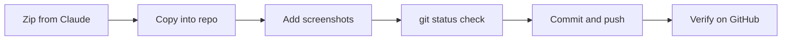

# Lab 00: Demo Lab (Practice Delivery)

> **This is a demo.** It exists only to practice the full workflow: unzip, copy into the repo, add screenshots, check links, push from VS Code, and verify on GitHub. It will be deleted afterwards.

## Overview

This demo mirrors the structure of every real lab write-up in this portfolio. It shows how sections, tables, a diagram and screenshots fit together.

## Objectives

- Practice merging a lab folder into the repo without overwriting anything
- Practice the screenshot naming and linking rules
- Practice checking that image links work on GitHub

## Azure Services Used

| Service | Purpose in this demo |
|---|---|
| None | The demo only practices the Git workflow |

## Architecture

## Configuration Summary

| Setting | Value |
|---|---|
| Folder | `00-demo-lab` |
| Images folder | `00-demo-lab/images` |
| Image naming | lowercase, hyphens, no spaces |

## Implementation Steps

### 1. First screenshot

A plain blue placeholder, standing in for a real portal screenshot.

### 2. Second screenshot

A plain green placeholder, standing in for a successful result.

## Troubleshooting

**Symptom:** an image shows as a broken icon on GitHub.
**Likely cause:** the file name in the README differs from the real file, often in upper or lower case, or the image was never pushed.
**Fix:** compare names exactly, check `git status` before committing, and verify on github.com.

## Security Considerations

- Redact IPs, IDs, emails and resource URLs in real screenshots.
- Never add the lab PDF, because it contains credentials.

## Key Takeaways

- Relative image links keep screenshots inside the repo.
- GitHub is case-sensitive, while a Mac is not.
- `git status` before `git add .` prevents mistakes.

## AZ-900 Concept Mapping

| Concept | Where it appears |
|---|---|
| Not applicable | This demo has no Azure resources |

---

*Demo content written for practice. Real labs credit the Whizlabs lab environment here.*
