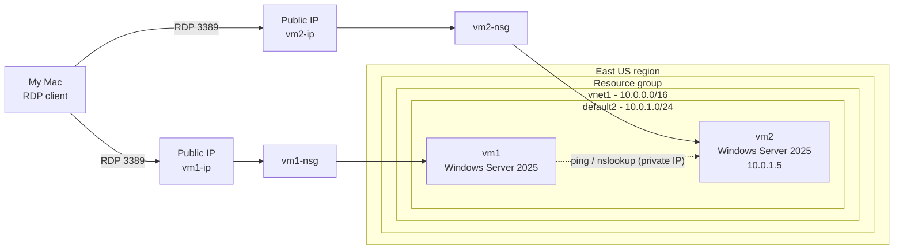

# Lab 04 - Create a Virtual Network and Test VM-to-VM Connectivity

## Overview

In this lab I built a private network in Azure from scratch, placed two Windows Server virtual machines inside it, and proved that they can talk to each other over private IP addresses.

The first ping between the VMs **failed**. Finding out why and fixing it turned out to be the most valuable part of the lab, so I documented the troubleshooting too (see [Troubleshooting](#troubleshooting-ping-request-timed-out)).

## Objectives

- Create a virtual network (VNet) with an address space and a subnet
- Deploy two Windows Server VMs into that subnet
- Allow ICMP (ping) traffic using a Network Security Group (NSG) rule
- Connect to the VMs using Remote Desktop (RDP)
- Verify private connectivity and name resolution between `vm1` and `vm2`
- Diagnose and fix a failed connectivity test
- Clean up all resources to avoid unnecessary cost

## Azure Services Used

| Service | Purpose in this lab |
|---|---|
| Virtual Network (VNet) | Private network that holds both VMs |
| Subnet | Smaller IP range inside the VNet where the VMs live |
| Virtual Machines | Two Windows Server 2025 machines used to test connectivity |
| Network Security Group (NSG) | Cloud firewall rules controlling traffic to each VM |
| Public IP address | Lets me reach each VM over RDP from outside Azure |
| Managed Disk | OS disk for each VM (Standard SSD) |
| Resource Group | Container that holds and groups all lab resources |

## Architecture

## Configuration Summary

| Setting | Value |
|---|---|
| Region | East US |
| Virtual network name | `vnet1` |
| VNet address space | `10.0.0.0/16` (65,536 addresses) |
| Subnet name | `default2` |
| Subnet range | `10.0.1.0/24` (256 addresses) |
| VM names | `vm1`, `vm2` |
| VM image | Windows Server 2025 Datacenter: Azure Edition (x64 Gen2) |
| VM size | Standard B2s (2 vCPU, 4 GiB RAM) |
| OS disk | Standard SSD (locally redundant) |
| Availability | No infrastructure redundancy required |
| Inbound ports at creation | HTTP (80), SSH (22), RDP (3389) |
| Extra NSG rule | Allow ICMP, priority 350, name `ICMP` |
| Boot diagnostics | Disabled |

## Implementation Steps

### 1. Create the virtual network

I searched for **Virtual networks** in the portal, selected **+ Create**, chose the lab's resource group, named the network `vnet1`, and set the region to East US.

On the **IP addresses** tab I kept the default `10.0.0.0/16` address space and added a subnet called `default2` with the range `10.0.1.0/24`.

After **Review + create**, the deployment finished successfully.

### 2. Deploy two virtual machines

I created `vm1` with the Windows Server 2025 image, size B2s, a Standard SSD OS disk, and the inbound ports RDP/HTTP/SSH allowed.

On the **Networking** tab I attached it to `vnet1` and the `default2` subnet. I also disabled boot diagnostics on the Monitoring tab.

I repeated the same process for `vm2`, using the same VNet and subnet. Both VMs ended up in the **Running** state.

### 3. Allow ICMP in the Network Security Group

On `vm2`, under **Network settings**, I added an inbound port rule: protocol **ICMP**, action **Allow**, priority **350**, name `ICMP`.

### 4. Connect with RDP and open the Windows firewall for ICMP

I downloaded the RDP file from the **Connect** page of each VM and signed in with the administrator account I created. Since I'm on a Mac, I used the Windows App / Microsoft Remote Desktop client.

Inside `vm2`, I opened **Windows Defender Firewall with Advanced Security**, went to **Inbound Rules**, and enabled the *File and Printer Sharing (Echo Request - ICMPv4-In)* rules.

### 5. Test the connection

From PowerShell (run as Administrator) on `vm1`, I ran `nslookup vm2` and `ping vm2`.

My first attempt failed: DNS worked, but every ping timed out.

After fixing the problem on `vm2` (explained below), the ping succeeded with 0% packet loss.

### 6. Validate and clean up

I ran the lab validation and it confirmed a successful result.

Finally, I deleted every resource in the lab's resource group so nothing keeps running or costing money.

## Troubleshooting: Ping "Request timed out"

**Symptom:** `ping vm2` from `vm1` returned 4 timeouts (100% loss), but `nslookup vm2` returned the correct private IP `10.0.1.5`.

**What that told me:**

- DNS resolution worked, so both VMs were in the same virtual network and Azure's internal DNS knew about `vm2`.
- The network path was fine. Something on the destination (`vm2`) was silently dropping ICMP echo requests.

**Likely causes I checked:**

1. The Windows Firewall ICMP rule on `vm2` was missing, disabled, or applied to a different network profile.
2. The ICMP allow rule had been added to the wrong NSG (`vm1-nsg` instead of `vm2-nsg`).
3. The firewall change was made on `vm1` instead of the VM being pinged.

**Fix:** I made sure ICMPv4 inbound was allowed in the Windows Firewall **on vm2** (the machine receiving the ping), for all network profiles. Afterwards, `ping vm2` replied successfully.

**Lesson learned:** Connectivity in Azure is controlled in two layers: the **NSG** (outside the VM) and the **operating system firewall** (inside the VM). Both must allow the traffic, and the rule has to be on the *destination* machine.

## Security Considerations

- **RDP open to the whole internet** (source: Any) is convenient for a lab but unsafe in real environments. In production I would restrict the source to my own IP, use **Azure Bastion**, or enable **Just-in-Time VM access**.
- Allowing **HTTP and SSH** on a Windows VM that does not need them widens the attack surface. Only open the ports a workload really needs.
- The **ICMP rule** is for testing only; ICMP is often blocked in production.
- Network and OS firewalls work together (defense in depth).
- I deleted all resources after the lab to avoid leftover exposure and cost.
- Screenshots were **redacted** (subscription IDs, public IPs, correlation IDs and account emails) before publishing. No credentials are stored in this repository.

## Key Takeaways

- A VNet is a private, isolated network in Azure; subnets divide it into smaller ranges.
- VMs in the same VNet can communicate over **private IPs** without going through the internet.
- Azure provides internal **DNS name resolution** between VMs in the same VNet.
- NSGs filter traffic at the network level, while the guest OS firewall filters at the machine level.
- Good troubleshooting is about isolating layers: DNS worked, so I could focus on filtering.
- Always clean up lab resources to control cost.

## AZ-900 Concept Mapping

| Concept | Where it appeared in this lab |
|---|---|
| Azure regions | Everything deployed in East US |
| Resource groups | All resources grouped and deleted together |
| IaaS (Infrastructure as a Service) | Windows Server VMs I manage myself |
| Virtual networks and subnets | `vnet1` and `default2` |
| Network Security Groups | `vm1-nsg`, `vm2-nsg`, and the ICMP rule |
| Public vs private IP addresses | RDP via public IP; ping via private IP |
| Shared responsibility model | Azure secures the platform; I manage the OS firewall |
| Cost management | Standard SSD, B-series VM, and resource deletion |

**Also relevant for AZ-104:** VNet and subnet design, NSG rule priority, VM deployment, and connectivity troubleshooting..
---