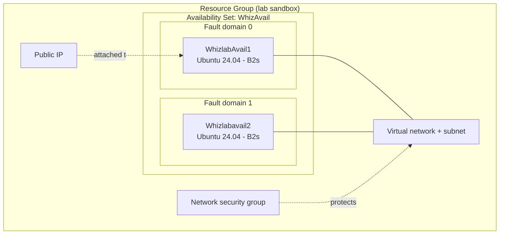
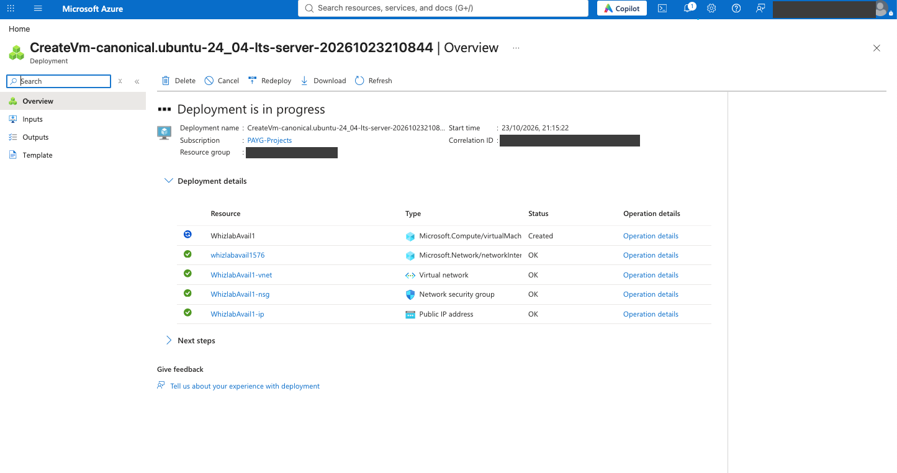
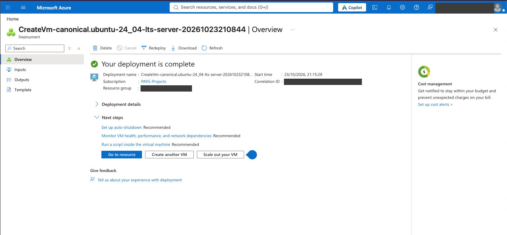
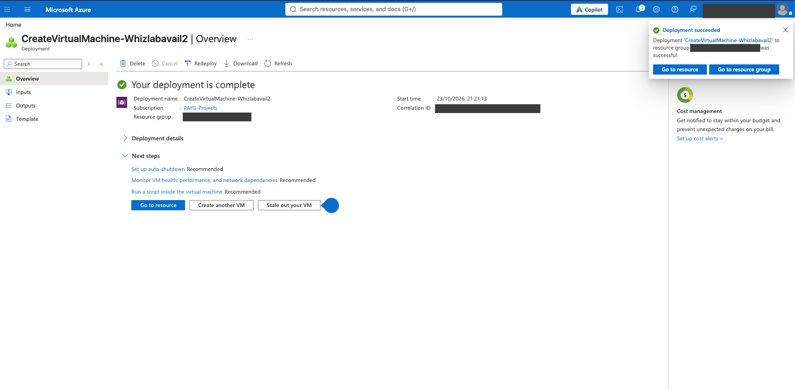
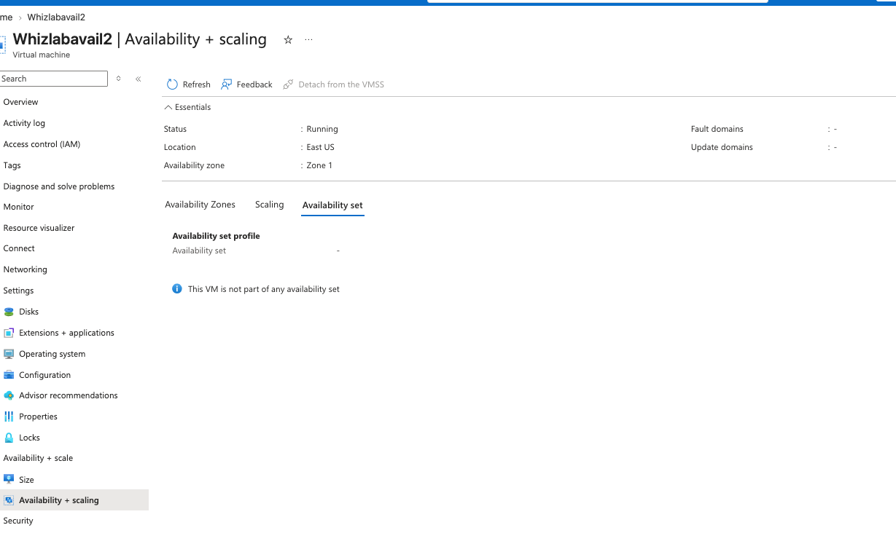

# Lab 05 – Create an Availability Set and Deploy Two Virtual Machines

## Overview

In this hands-on lab I created an **Azure Availability Set** and deployed an Ubuntu Linux virtual machine into it. I then deployed a second VM to follow the Microsoft recommendation of **at least two VMs per availability set**.

An availability set protects an application from hardware failures and planned maintenance inside a single datacenter. Azure spreads the VMs across separate **fault domains** (separate racks with their own power and network) and **update domains** (groups that are rebooted one at a time during maintenance).

> **Real-life analogy:** Think of two cashiers in a supermarket. If both sit at the same till and the power fails, the shop stops. If they sit at two tills on two different power lines, the shop keeps serving customers.

While verifying the result I found that my second VM did **not** end up inside the availability set. I documented what I saw and what I learned in the [Troubleshooting](#troubleshooting--observation) section.

## Objectives

- Create an availability set in the Azure portal
- Deploy a Linux VM and attach it to the availability set
- Deploy a second VM following the same procedure
- Verify availability settings on the VM's **Availability + scaling** page
- Clean up all resources at the end of the lab

## Azure services used

| Service | Purpose in this lab |
|---|---|
| Availability Set | Spreads VMs across fault and update domains |
| Azure Virtual Machine (Ubuntu Server 24.04 LTS) | The workload that needs high availability |
| Virtual Network and subnet | Network created with the VM (`default` subnet, VM got private IP `10.0.0.4`) |
| Network Security Group | Firewall rules created with the VM |
| Public IP address | Created with the VM for remote access |
| Resource Group | Container for all lab resources |

## Architecture

Target design of the lab: two VMs in one availability set, spread over separate fault domains.

## Configuration

| Setting | Value |
|---|---|
| Availability set name | `WhizAvail` |
| Region | East US (as shown in my deployment; the lab guide text mentions Central US) |
| Fault domains / update domains | Lab form defaults (2 fault domains, 5 update domains) |
| VM 1 name | `WhizlabAvail1` |
| VM 2 name | `Whizlabavail2` |
| Image | Ubuntu Server 24.04 LTS (Canonical), x64 Gen2 |
| Size | Standard B2s (2 vCPUs, 4 GiB RAM) |
| Security type | Standard |
| Authentication | Password |
| OS disk | Standard SSD |
| Availability option on VM 1 | Availability set `WHIZAVAIL`, fault domain 0 |

## Implementation steps

### Task 1 – Sign in to the Azure portal
I opened the Azure portal in a private browser window and signed in with the temporary sandbox account provided by the lab environment.

### Task 2 – Create the availability set
1. **Create a resource** and searched for **Availability Set**.
2. Selected the lab resource group, named the set `WhizAvail`, and chose the region.
3. Kept the default fault domain and update domain counts, then **Review + create** and **Create**.

### Task 3 – Deploy the first VM into the set
1. **Create a resource** > **Compute** > **Virtual machine**.
2. On the Basics tab I set the name to `WhizlabAvail1`, **Availability options = Availability set**, and picked `WhizAvail`.
3. Image: Ubuntu Server 24.04 LTS Gen2, size B2s, password authentication, OS disk type Standard SSD.
4. **Review + create**, then **Create**. The deployment created the VM plus its network interface, virtual network, network security group and public IP.

### Task 4 – Deploy the second VM
I repeated the VM creation steps for `Whizlabavail2` and waited for the deployment to succeed.

### Task 5 – Verify the availability settings
On `WhizlabAvail1`, the **Availability + scaling** section of the overview shows the availability set `WHIZAVAIL`, with the fault domain assigned by Azure. The red arrow marks the key line.

Then I opened **Availability + scaling** on `Whizlabavail2`.

### Task 6 – Clean up
I deleted all resources in the lab resource group so nothing keeps running or costing money.

## Troubleshooting / Observation

**Symptom**
On `Whizlabavail2`, the *Availability set* tab says *"This VM is not part of any availability set"*, and the Essentials panel shows **Availability zone: Zone 1**. `WhizlabAvail1`, in contrast, shows the availability set `WHIZAVAIL` and no zone.

**Reasoning**
- A VM can use an **availability zone** *or* an **availability set**, never both. A VM in Zone 1 cannot also be in a set.
- The deployment name of VM 2 (`CreateVirtualMachine-...`) differs from VM 1 (`CreateVm-canonical...`), which suggests the second VM was created through a different, newer create flow whose default availability option was a zone, not a set.

**Fix**
The availability option is chosen when the VM is created. To put `Whizlabavail2` into `WhizAvail`, I would re-create the VM and, on the Basics tab, explicitly set **Availability options = Availability set** and pick `WhizAvail` before clicking Create.

**Lesson learned**
Never assume the second VM inherited the settings of the first. Always check **Availability + scaling** on every VM after deployment. Verifying the result is part of the job, not only clicking through the steps.

## Security considerations

- Passwords on VMs are fine for a short-lived sandbox, but in real environments I would use **SSH keys** and restrict inbound access with the NSG or use **Azure Bastion**.
- Sandbox credentials, subscription ID, public IP, correlation IDs and resource group names are **redacted** in all screenshots.
- All resources were deleted at the end of the lab to avoid unnecessary cost and attack surface.

## Key takeaways

- Availability sets protect against **rack-level hardware failures** and **planned maintenance** inside one datacenter. They do not protect against a full datacenter outage.
- **Fault domain** = shared power and network (failure). **Update domain** = reboot group (maintenance).
- Use **at least two VMs** in a set. A set with one VM gives no real benefit.
- The availability option is decided **at VM creation time**, so check it before you click Create.
- Availability zones give stronger protection than sets because they span separate datacenters in a region.

## Exam concept mapping

| Concept | AZ-900 | AZ-104 |
|---|---|---|
| Availability sets, fault domains, update domains | Yes | Yes |
| Availability zones vs sets (they cannot be combined on one VM) | Yes | Yes |
| Azure SLA: 99.95% for 2+ VMs in a set, 99.99% for 2+ VMs across zones | Yes | Yes |
| Regions and resource groups | Yes | Yes |
| Deploying and configuring VMs, sizes and disks | Light | Yes |
| Network interface, VNet, NSG and public IP created with a VM | Light | Yes |

## Credits

Lab environment provided by [Whizlabs](https://www.whizlabs.com/). The write-up, screenshots and observations are my own.
