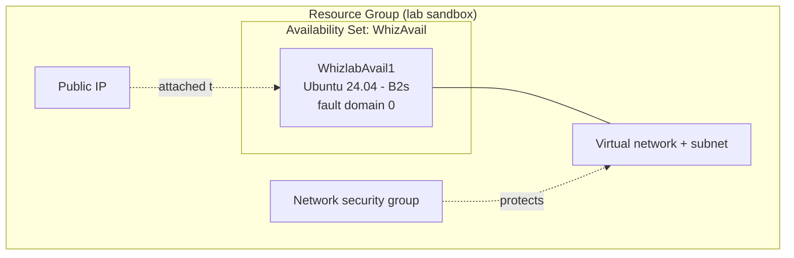
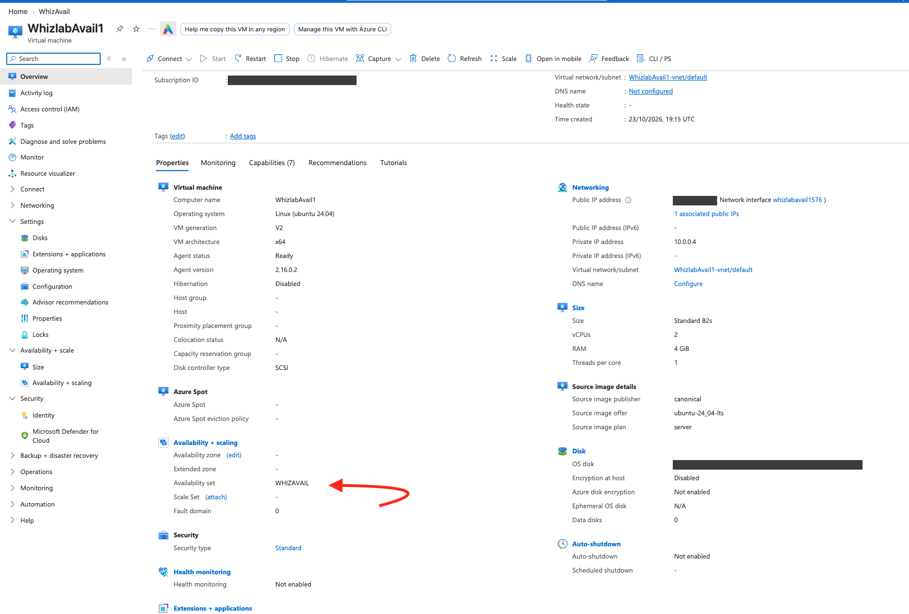

# Lab 05 – Create an Availability Set and Deploy a Virtual Machine into It

## Overview

In this hands-on lab I created an **Azure Availability Set** and deployed an Ubuntu Linux virtual machine into it, then verified in the portal that the VM belongs to the set.

An availability set protects an application from hardware failures and planned maintenance inside a single datacenter. Azure spreads the VMs of a set across separate **fault domains** (separate racks with their own power and network) and **update domains** (groups that are rebooted one at a time during maintenance).

> **Real-life analogy:** Think of two cashiers in a supermarket. If both sit at the same till and the power fails, the shop stops. If they sit at two tills on two different power lines, the shop keeps serving customers. The availability set is the rule that says "never put them on the same line".

## Objectives

- Create an availability set in the Azure portal
- Deploy a Linux VM and attach it to the availability set
- Verify the availability settings on the VM's overview page
- Clean up the lab resources

## Azure services used

| Service | Purpose in this lab |
|---|---|
| Availability Set | Spreads VMs across fault and update domains |
| Azure Virtual Machine (Ubuntu Server 24.04 LTS) | The workload placed in the set |
| Virtual Network and subnet | Network created with the VM (`default` subnet, VM got private IP `10.0.0.4`) |
| Network Security Group | Firewall rules created with the VM |
| Public IP address | Created with the VM for remote access |
| Resource Group | Container for all lab resources |

## Architecture

## Configuration

| Setting | Value |
|---|---|
| Availability set name | `WhizAvail` |
| Region | East US |
| Fault domains / update domains | Lab form defaults (2 fault domains, 5 update domains) |
| VM name | `WhizlabAvail1` |
| Image | Ubuntu Server 24.04 LTS (Canonical), x64 Gen2 |
| Size | Standard B2s (2 vCPUs, 4 GiB RAM) |
| Security type | Standard |
| Authentication | Password |
| OS disk | Standard SSD |
| Availability option | Availability set `WHIZAVAIL`, fault domain 0 |

## Implementation steps

### Task 1 – Sign in to the Azure portal
I opened the Azure portal in a private browser window and signed in with the temporary sandbox account provided by the lab environment.

### Task 2 – Create the availability set
1. **Create a resource** and searched for **Availability Set**.
2. Selected the lab resource group, named the set `WhizAvail`, and chose the region.
3. Kept the default fault domain and update domain counts, then **Review + create** and **Create**.

### Task 3 – Deploy the VM into the set
1. **Create a resource** > **Compute** > **Virtual machine**.
2. On the Basics tab I set the name to `WhizlabAvail1`, **Availability options = Availability set**, and picked `WhizAvail`.
3. Image: Ubuntu Server 24.04 LTS Gen2, size B2s, password authentication, OS disk type Standard SSD.
4. **Review + create**, then **Create**. The deployment created the VM plus its network interface, virtual network, network security group and public IP.

### Task 4 – Verify the availability set
On the VM overview, the **Availability + scaling** section shows the availability set `WHIZAVAIL` and the fault domain Azure assigned. The red arrow marks the key line.

### Task 5 – Clean up
I deleted the resources in the lab resource group so nothing keeps running or costing money.

## Security considerations

- Passwords on VMs are fine for a short-lived sandbox, but in real environments I would use **SSH keys** and restrict inbound access with the NSG or use **Azure Bastion**.
- Sandbox credentials, subscription ID, public IP, correlation IDs and resource group names are **redacted** in all screenshots.
- Resources were deleted at the end of the lab to avoid unnecessary cost and attack surface.

## Key takeaways

- Availability sets protect against **rack-level hardware failures** and **planned maintenance** inside one datacenter. They do not protect against a full datacenter outage.
- **Fault domain** = shared power and network (failure). **Update domain** = reboot group (maintenance).
- Microsoft recommends **at least two VMs** in a set. A set with a single VM gives no real benefit.
- The availability option is decided **at VM creation time**, so check it before you click Create.
- Availability zones give stronger protection than sets because they span separate datacenters in a region. A VM uses a zone **or** a set, never both.

## Exam concept mapping

| Concept | AZ-900 | AZ-104 |
|---|---|---|
| Availability sets, fault domains, update domains | Yes | Yes |
| Availability zones vs sets (they cannot be combined on one VM) | Yes | Yes |
| Azure SLA: 99.95% for 2+ VMs in a set, 99.99% for 2+ VMs across zones | Yes | Yes |
| Regions and resource groups | Yes | Yes |
| Deploying and configuring VMs, sizes and disks | Light | Yes |
| Network interface, VNet, NSG and public IP created with a VM | Light | Yes |

## Credits

Lab environment provided by [Whizlabs](https://www.whizlabs.com/). The write-up and screenshots are my own.
